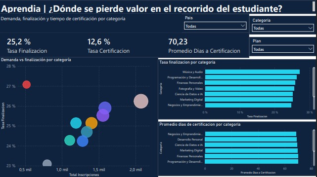
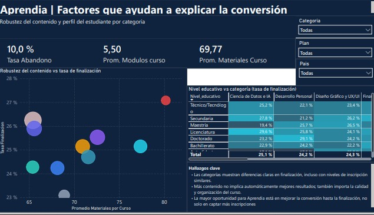

# AprendIA en Power BI

Las capturas provienen de las páginas 14 y 15 de la presentación final del bootcamp. El proyecto se realizó en equipo con Manuela Zapata Jiménez, Astrid Rodríguez y Valerie Avendaño. Adaptamos las vistas a tres preguntas sobre el negocio, el recorrido de aprendizaje y la conversión.

## Recorrido del estudiante



La página cruza volumen de inscripciones y tasa de finalización por categoría. Las tarjetas resumen el porcentaje de inscripciones finalizadas, certificados frente a inscripciones y tiempo promedio hasta la certificación. Los segmentadores permiten explorar el país, la categoría y el plan según las relaciones del modelo.

## Exploración de la conversión



La página compara profundidad de contenido y finalización por categoría. La matriz usa nivel educativo y categoría para explorar diferencias de composición. La visualización plantea hipótesis sobre el avance del estudiante. Para comparar contenido y resultados hay que comprobar que cada lección tenga un módulo y que los cortes sean equivalentes.

## Modelo y medidas

Los indicadores de aprendizaje se calculan sobre `Inscripcion`, conectada a `Usuario` y `Curso`. La ruta de monetización va de `Pago` a `Suscripcion` y de ahí a `Plan`. La jerarquía de contenido enlaza `Curso`, `Modulo`, `Leccion` y `Material_leccion`. `Certificado` comparte los campos de usuario y curso con las inscripciones.

Medidas de la plantilla de Power BI. En el modelo, las tablas llevan el prefijo `plataforma_cursos_aprendia` seguido de un espacio.

```dax
Total Inscripciones = COUNTROWS('plataforma_cursos_aprendia inscripcion')

Inscripciones Completadas =
CALCULATE(
    COUNTROWS('plataforma_cursos_aprendia inscripcion'),
    'plataforma_cursos_aprendia inscripcion'[Estado] = "completado"
)

Tasa Finalizacion = DIVIDE([Inscripciones Completadas], [Total Inscripciones], 0)

Total Certificados = COUNTROWS('plataforma_cursos_aprendia certificado')

Tasa Certificacion = DIVIDE([Total Certificados], [Total Inscripciones], 0)

Ingresos Reales =
CALCULATE(
    SUM('plataforma_cursos_aprendia pago'[Monto]),
    'plataforma_cursos_aprendia pago'[Estado] = "completado"
)
```

La medida de duración se calcula con `DATEDIFF` después de localizar la fecha de inscripción por la pareja usuario–curso. El tablero muestra **70,23 días**. El [cuaderno de Python](../analisis_aprendia.ipynb) identifica una fecha invertida en el extracto de Power BI y recalcula **70,28 días** con los intervalos cronológicamente válidos.

El análisis de cobertura de claves explica por qué los promedios de módulos, lecciones y materiales de la presentación se deben consultar junto con el corte usado para calcularlos. Los resultados de las capturas corresponden a la presentación y los controles reproducibles usan el extracto de Excel incluido en forma agregada.
